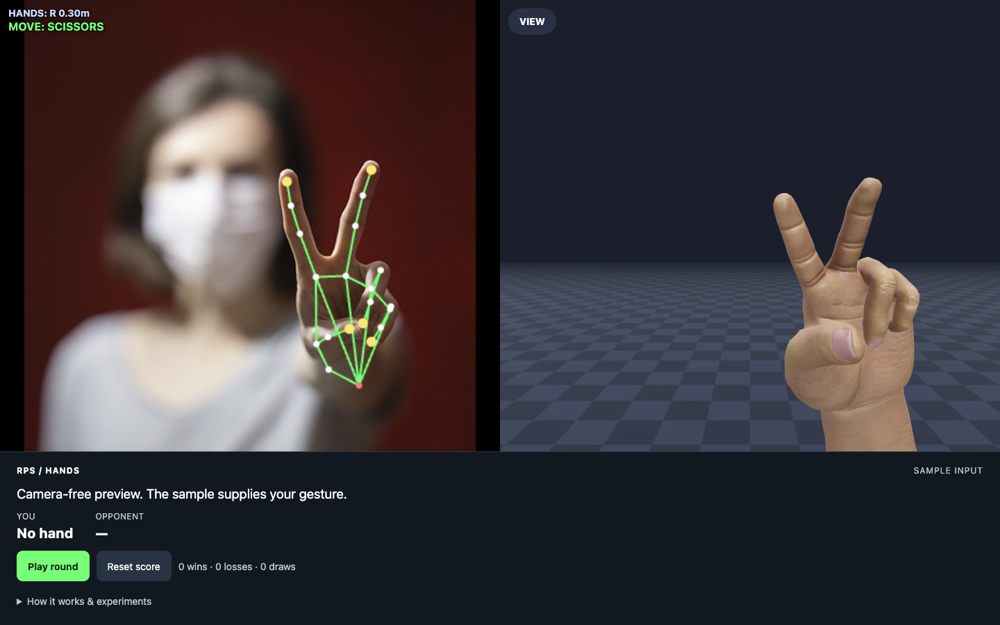
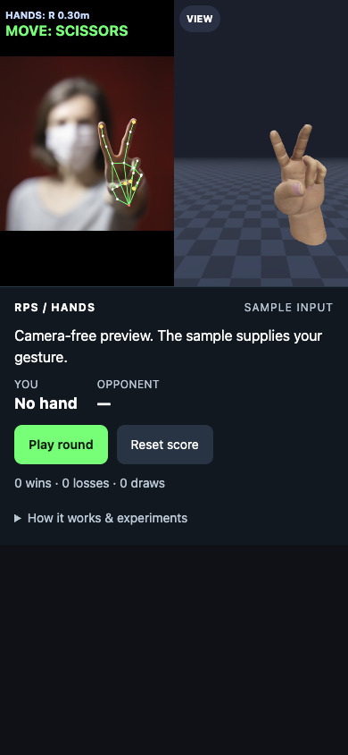

# RPS Hand

Rock-paper-scissors in the browser with live hand tracking: MediaPipe finds the 21 joints of your hand and a rigged 3D hand copies the pose in real time.

**Live demo:** https://d14life.github.io/rps-hand/ · no camera? [Try the sample image](https://d14life.github.io/rps-hand/?img=victory.jpg)





## What it does

- Tracks one hand from the front camera with MediaPipe HandLandmarker in a Web Worker (GPU, with a CPU fallback) and draws the landmarks over the mirrored video.
- Reads the gesture from the extended fingers: none up = rock, three or more = paper, index and middle only = scissors.
- Plays a round against a random opponent whose move is drawn when you press **Play round**. After a 3-second countdown it scores only a gesture seen in the last 500 ms and held for at least 400 ms; otherwise it asks you to retry and leaves the score unchanged.
- Drives a rigged, textured 3D hand with a short forearm (three.js) from the tracked joints. **VIEW** switches between a mirror view and a first-person view projected from your head position (MediaPipe PoseLandmarker in a second worker).
- Works without a camera: `?img=victory.jpg` feeds a still photo through the same tracker. If camera access is denied, the page offers the sample and a retry button.
- Fits phone screens (camera and 3D panes side by side in a strip, controls below, 44 px buttons, the whole camera frame visible) and levels the 3D room with the phone's tilt sensor.
- Camera frames stay in the browser; only the libraries and models are downloaded from a CDN.

URL parameters: `img=<file>` (still image instead of the camera), `video=test/rps.webm` (looping clip), `view=0|1` (first person / mirror), `hands=2` (track two hands; a round needs exactly one), `gun=1` (a pistol on the table that the tracked hand can pick up and fire), `delegate=CPU`, `lines=1` (skeleton over the 3D hand).

## Tech

HTML and ES modules with no build step · three.js 0.186 · MediaPipe Tasks Vision 1.0.1 (HandLandmarker, PoseLandmarker) · Web Workers · GitHub Pages · Node test runner and Playwright · desktop version: Python, MediaPipe GestureRecognizer, OpenCV, pygame and PyOpenGL.

## Run it

```sh
git clone https://github.com/d14life/rps-hand.git
cd rps-hand
python3 -m http.server 8765 --bind 127.0.0.1 --directory docs
# open http://127.0.0.1:8765/  or, without a camera, http://127.0.0.1:8765/?img=victory.jpg
```

The browser only allows the camera on `localhost`/`127.0.0.1` or HTTPS. An internet connection is needed for three.js, MediaPipe and the models.

Desktop version (written for Windows; the webcam is opened through DirectShow):

```sh
pip install mediapipe opencv-python pygame PyOpenGL numpy
python rps_hand.py                                              # webcam 0; SPACE plays a round, ESC quits
python rps_hand.py --source assets/victory.jpg --shot out.png   # render a still image and exit
python -m PyInstaller --noconfirm --clean --onefile --windowed --name RPSHand --add-data "assets/gesture_recognizer.task;assets" --collect-all mediapipe rps_hand.py   # Windows .exe
```

## Tests

```sh
npm test                                  # Node test runner: round rules, tracking maths, lab modules
npm ci && npx playwright install chromium
python3 -m http.server 8765 --bind 127.0.0.1 --directory docs &
npm run test:browser                      # real tracker reads SCISSORS from the sample, VIEW toggles, no overflow at 390 px, no errors
npm run test:alignment                    # geometry lab: rig alignment and bone-length checks
node tools/product-journey.cjs            # full round, reset, mobile layout, denied-camera recovery
python test_rps_hand.py                   # desktop: bone retargeting, finger-count fallback, still-image self-check
```

CI (`.github/workflows/logic-tests.yml`) runs `npm test`, `test:browser` and `test:alignment` on every push. `npm test` currently reports 690 passing checks in 229 files; many of those files are copies inside archived lab versions, so they are not 690 separate features. `web_test.py`, `web_hard_test.py` (labelled photos and clips from `fetch_test_media.py`, run in the system Edge) and `web_shot.py` are older Python harnesses outside CI.

## Experiments on the same site

Research prototypes, not part of the game:

- [Movement](https://d14life.github.io/rps-hand/movement/): walk the Dust II map with a camera thumb joystick and head look, with a phone-as-camera link, shooting range, punching bag and a ball-joint doll as the player's body.
- [Geometry lab](https://d14life.github.io/rps-hand/hand-pnp-photo/): palm pose (PnP) from a photo-fitted reference hand, alignment checks, JSON export.
- [Face & hand lab](https://d14life.github.io/rps-hand/hand-demo/): face and hand tracking together, one-hand sweep and depth experiments.

## Credits

This repository is a fork of the team project **[tagirz500/hands-lapse](https://github.com/tagirz500/hands-lapse)** (first published as `rps-hand`) by **tagirz500** and **ArmanFardin**. Their commits are kept in this history as they authored them.

- **tagirz500** built the original web hand tracker (HandLandmarker in a worker, One Euro filtering with prediction, 3D hand placement from world and image landmarks, two hands with Rapier physics, a first-person view) and its tuning builds, the Python desktop app and its test, the web test harness and test-media script, and in the movement demo the phone-as-camera QR link and multiplayer.
- **ArmanFardin** built the movement prototype (the Dust II map with walking collisions and stair stepping, the camera thumb joystick, head-look turning and their tests) and the MediaPipe 3D hand-rig phone test in `docs/rig-test/`, a build of bandinopla's three-mediapipe-rig demo.

**Damire Zalyatov's additions** in this fork:

- Rigged 3D hand and arm models driven by the tracked joints (a hand scan and textured arms, `docs/*.glb`), with a solid-hand solver and finger collisions.
- Head-tracked first-person view, face and upper-body tracking, avatar, 3D mirror and calibration (`docs/head`, `docs/body`, `docs/avatar`).
- A pistol on the table that the tracked hand can pick up and fire (`docs/gun.mjs`), plus gun-grip and shooting-range labs.
- Movement versions 63 to 90: shooting range, punching bag, synthesized sounds, wall mirror, the ball-joint doll as the player's body (`docs/doll`, `tools/doll`) and a phone link that sends landmarks over MQTT, so it works across networks.
- QR phone-camera pairing for the labs (`docs/shared-phone`).
- Hand-tracking geometry labs (`docs/hand-*`): PnP and sweep fits, depth experiments, touch calibration and joint limits.
- The playable round layer (`docs/rps-game.mjs`, `docs/rps-ui.mjs`), the mobile layout, camera-denial recovery, the browser tests and CI.

## Licence

Neither the upstream project nor this fork has a licence file, so the project code is not licensed for reuse; copyright stays with its authors. Third-party parts keep their own licences: MediaPipe (Apache-2.0, texts in `docs/head/` and `docs/google-hands/`), three.js and MediaPipe Tasks Vision (loaded from jsDelivr), MQTT.js and QRCode.js (`docs/vendor/`). Most test photos and clips in `docs/test/` come from Wikimedia Commons (listed in `fetch_test_media.py`).

## Status / limits

Experimental. CI checks one sample photo (`victory.jpg`) in headless Chromium; tracking accuracy and frame rate on real phones have not been measured, and the desktop app has only been checked on still images (`test_rps_hand.py`), not with a live webcam.

Maintained by Damire Zalyatov · base project by tagirz500 and ArmanFardin.
